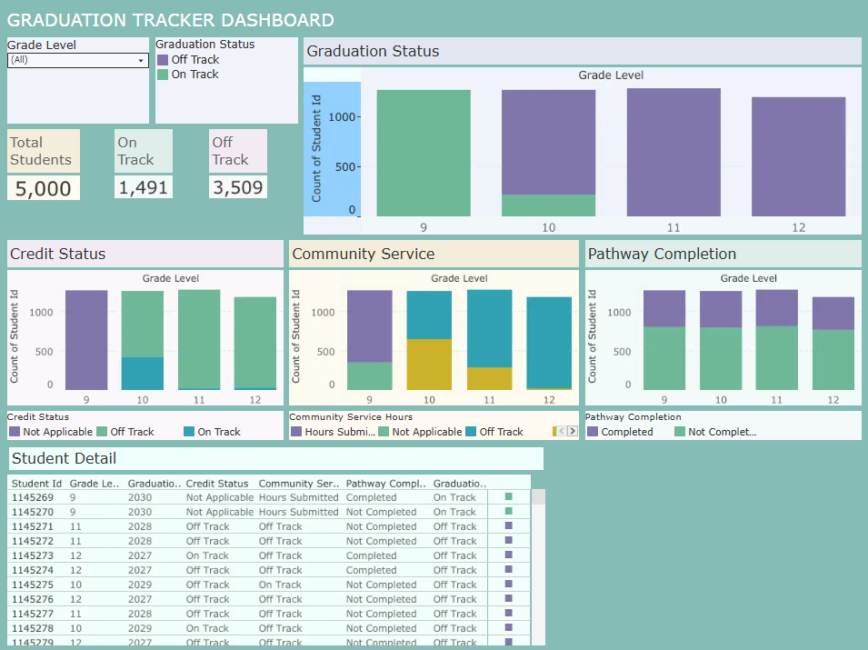

# graduation-tracker-ews
Synthetic student information system and graduation readiness analytics using Python, PostgreSQL, and Tableau.

## Interactive Tableau Dashboard

Explore the Graduation Tracker dashboard to examine student graduation readiness, credit status, community service completion, and graduation pathway completion.

[View the Interactive Graduation Tracker Dashboard](https://public.tableau.com/views/PennsylvaniaGraduationTracker/Dashboard)
  

